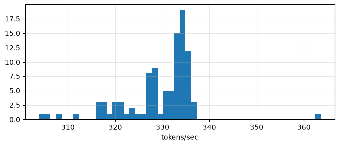
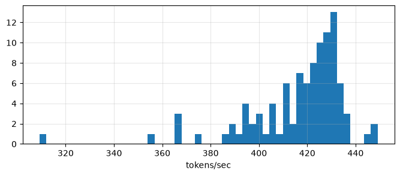

# Once upon a GPU: really bad bedtime stories from a 44m parameter transformer

Small language models trained from scratch on TinyStories with one consumer GPU (an RTX 5060 Ti): an LSTM, two transformers, and the best transformer post-trained with direct preference optimisation (DPO), using a local LLM as the judge. The last section measures inference speed with and without a key-value cache.

The best model has 43.8m parameters and a validation loss of 1.36 (3.88 perplexity). After DPO, the judge prefers its stories over the original model's 56.2% of the time. A key-value cache raises generation speed from 330 to 416 tokens/sec.

A sample at a temperature of 0.75:

> A long, long time ago, there was a big, hairy bear. He was very angry because someone was trying to cut down his tree. He had a lot of hope to get his tree back. But then, he saw a little bird fly down and land on his shoulder. The bird had a hurt wing and couldn't fly. The bear felt sorry for the bird and decided to help. He gently picked up the bird and put it on a branch of the tree. The bird felt better and flew away. The bear was happy to have helped the little bird.

## 1. Data

TinyStories (Eldan and Li, 2023) has 2,119,719 training stories and 21,990 validation stories. Two tokenisations were used.

| Tokeniser | Vocabulary | Training tokens | Validation tokens | Used by |
|---|---|---|---|---|
| GPT-2 | 50,257 | 464,965,814 | 4,673,588 | LSTM, first transformer |
| GPT-Neo, retrained on TinyStories | 10,000 | 465,033,728 | 4,674,286 | GPT-Neo transformers |

Each story ends with an `<|endoftext|>` token. The token stream is cut into fixed-length sequences and read from a memory-mapped file.

## 2. Models

| Model | Parameters | Context | Val loss | Perplexity |
|---|---|---|---|---|
| LSTM, 2 layers of 768 | 18.1m | 128 | 2.92 | 18.51 |
| Transformer, 2 blocks, 768 feed-forward | 22.9m | 512 | 1.59 | 4.90 |
| Transformer, 4 blocks, 3024 feed-forward | 43.8m | 512 | 1.36 | 3.88 |
| 4 block transformer + DPO | 43.8m | 512 | not measured | not measured |

The weights are in `weights/` and tracked with git LFS, so run `git lfs pull` after cloning. The retrained tokeniser is in `weights/gpt-neo-10k-tokeniser`.

The LSTM numbers are from a one epoch run. The saved LSTM weights are from a 3 epoch run, which came out slightly worse (2.94 loss, 18.88 perplexity).

## 3. Experiments

### 3.1 LSTM

Notebooks: `src/notebooks/lstm`.

A hand-written LSTM cell was first tested on a toy task, recalling the first value of an 8-step binary sequence, and reached 100% test accuracy. On recalling a 4-value prefix from sequences of up to 64 steps, `nn.LSTM` was more accurate than `nn.RNN` at most lengths.

The language models were trained for one epoch on 128-token sequences with Adam at a learning rate of 1e-3.

| LSTM | Val loss | Perplexity |
|---|---|---|
| 1 layer | 3.34 | 28.23 |
| 1 layer, double width | 3.35 | 28.58 |
| 2 layers of 768 | 2.92 | 18.51 |

Width did not help and a second layer did. The gradient norm rose through training and was clipped to 1. Generated text is story-shaped but does not keep track of its characters; a girl becomes "he" one sentence later.

### 3.2 Transformers

Notebooks: `src/notebooks/transformers/01` and `02`.

The first transformer was written by hand with single-head attention: 16 blocks of width 256, a 128-token context and the GPT-2 tokeniser. After 3 epochs its training loss was about 4.52 (perplexity about 92), well behind the LSTM. Validation loss was not measured.

The second setup follows the GPT-Neo configuration in the TinyStories paper: a retrained 10,000-token vocabulary, multi-head attention with 8 heads, learned absolute positions and a 512-token context. Training used AdamW (learning rate 1e-3, weight decay 0.01), a batch size of 32, mixed precision and gradient clipping at 1.

| Blocks | Feed-forward width | Epochs | Parameters | Val loss | Perplexity |
|---|---|---|---|---|---|
| 2 | 768 | 2 | 22.9m | 1.59 | 4.90 |
| 4 | 3024 | 3 | 43.8m | 1.36 | 3.88 |

The paper reports losses below 1.5 for small transformers. Both models keep names and pronouns consistent through a story.

### 3.3 Direct preference optimisation

Notebooks: `src/notebooks/transformers/03` and `04`.

Prompts were the first sentences of 2,500 validation stories. The 4 block transformer wrote 4 completions per prompt at a temperature of 1, and qwen3.5:4b (through ollama) picked the best one. Completions were shuffled before judging, since the judge initially favoured the first one shown. This gave 7,482 preference pairs. DPO was run with β = 0.1, a learning rate of 5e-6 and a batch size of 16.

Evaluation used 500 new prompts, with one completion from each model per prompt. The judge preferred the DPO model on 281 of 500 (56.2%, 95% CI 51.7% to 60.6%; two-sided binomial test against 50%, p = 0.0063).

The DPO model's stories stay closer to the prompt. The result measures agreement with the judge, so the model may be learning the judge's biases.

### 3.4 Weight initialisation

Notes: `src/notebooks/transformers/05-weight-initialisation.md`.

A derivation of Glorot and He initialisation from the variance of the forward and backward passes. No experiment was run. PyTorch's defaults already apply these schemes, so the models were left unchanged.

### 3.5 Inference speed

Notebooks: `src/notebooks/inference`.

The benchmark generates up to 300 tokens from each of 100 prompts of 32 tokens, at a temperature of 0.75, using the 4 block transformer before DPO. Each step is timed after a GPU synchronisation. Tokens per second is the number of tokens generated divided by the total step time, so a story that ends early is counted at its actual length.

The cached model replaces `nn.MultiheadAttention` with a hand-written attention layer that returns its keys and values. The layer matches `nn.MultiheadAttention` on random input to within 1e-5. The prompt is passed through once to fill the cache, and each later step passes only the newest token. The trained weights load unchanged, apart from two renamed parameters per block.

| Tokens/sec over 100 prompts | Mean | Std | Median | Min | Max |
|---|---|---|---|---|---|
| Uncached | 329.7 | 7.9 | 332.6 | 303.9 | 363.5 |
| Key-value cache | 416.3 | 20.8 | 422.2 | 309.2 | 449.1 |

The cache raises mean speed by 86.7 tokens/sec (26%).

Uncached:



Key-value cache:



## 4. Layout

| Path | Contents |
|---|---|
| `src/models/` | the LSTM, the transformer, the cached attention layer and the sampling code |
| `src/training/` | the training loop |
| `src/data/` | the memory-mapped token dataset |
| `src/configs/` | dataclass configs |
| `src/notebooks/` | the experiments, in order: `token-embedding`, `lstm`, `transformers`, `inference` |
| `src/outputs/` | saved charts |
| `weights/` | trained weights and the tokeniser |

## 5. Running it

The notebooks are not a packaged pipeline. You will need the TinyStories parquet files from Hugging Face, the packages in `requirements.txt`, and for the judge, a running ollama server with qwen3.5:4b pulled. Copy `.env.example` to `.env` and set `TINYSTORIES_DIR` to the folder holding your data.

To load the best model and get a story out of it:

```python
import torch
from transformers import AutoTokenizer
from src.models.transformer_lm import GPTNeo
from src.models.generate import generate, pretty_print

device = torch.device('cuda' if torch.cuda.is_available() else 'cpu')
tokeniser = AutoTokenizer.from_pretrained('weights/gpt-neo-10k-tokeniser')

model = GPTNeo(4, 10_000, 768, 512, [3024] * 4, [8] * 4, dropout=[0] * 4).to(device)
model.load_state_dict(torch.load('weights/20260927_3024_4x_8_4x_0_4x_transformer_dpo.pt', map_location=device))

pretty_print(generate('Once upon a time,', model, tokeniser, device, temperature=0.75))
```

## References

- Eldan and Li (2023). TinyStories: How Small Can Language Models Be and Still Speak Coherent English?
- Rafailov et al. (2023). Direct Preference Optimization: Your Language Model is Secretly a Reward Model.
- Vaswani et al. (2017). Attention Is All You Need.
- Hochreiter and Schmidhuber (1997). Long Short-Term Memory.
- Glorot and Bengio (2010). Understanding the difficulty of training deep feedforward neural networks.
- He et al. (2015). Delving Deep into Rectifiers: Surpassing Human-Level Performance on ImageNet Classification.
